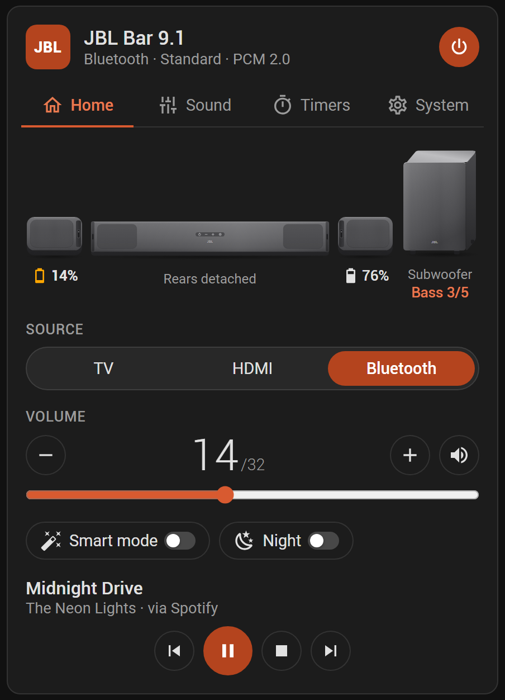
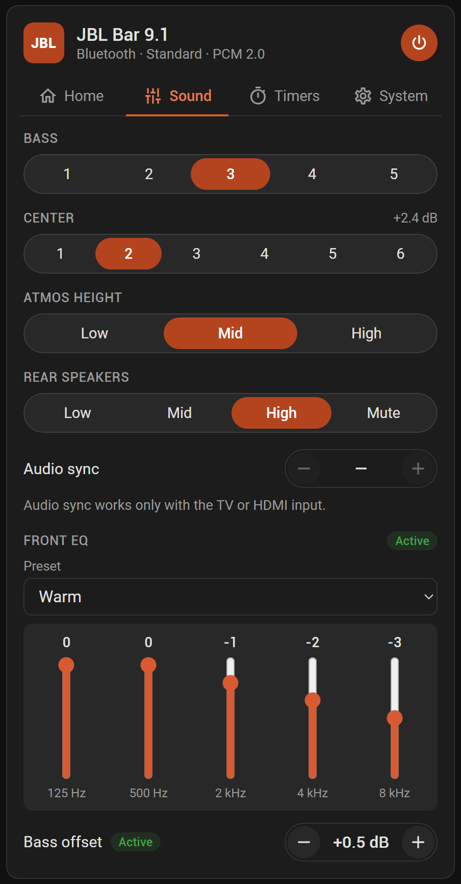
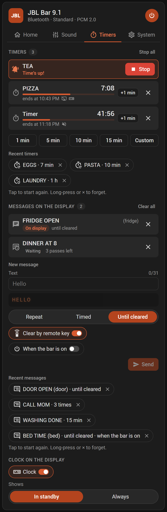
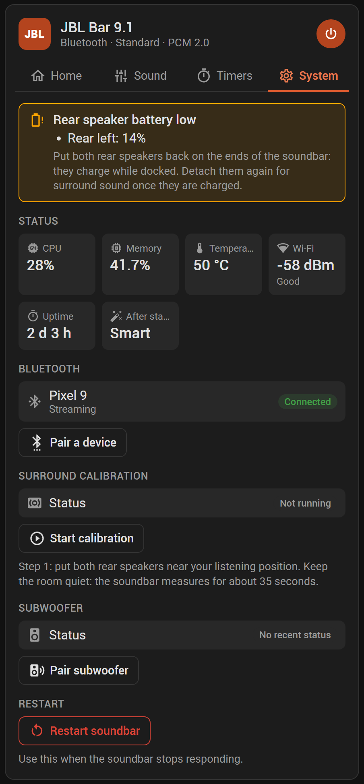
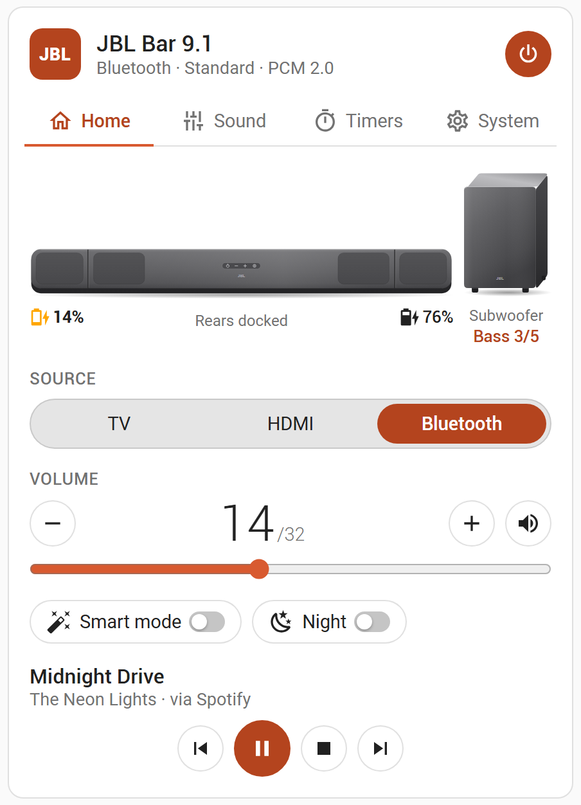
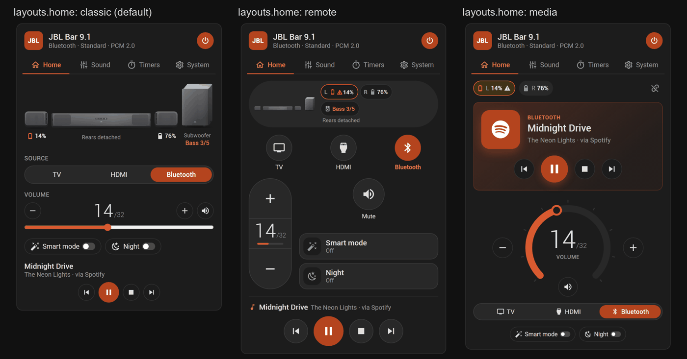
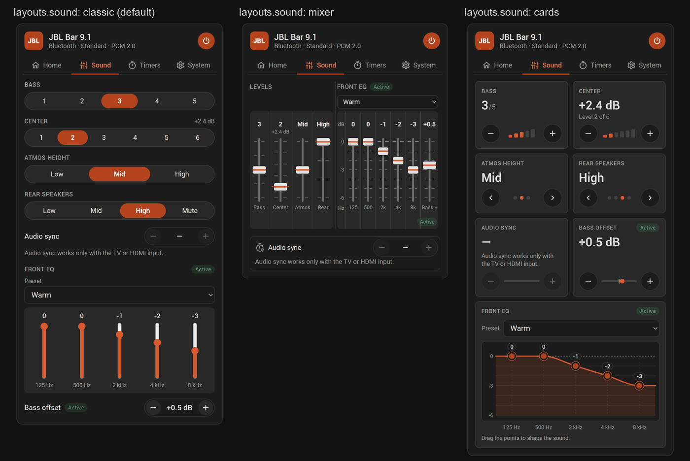
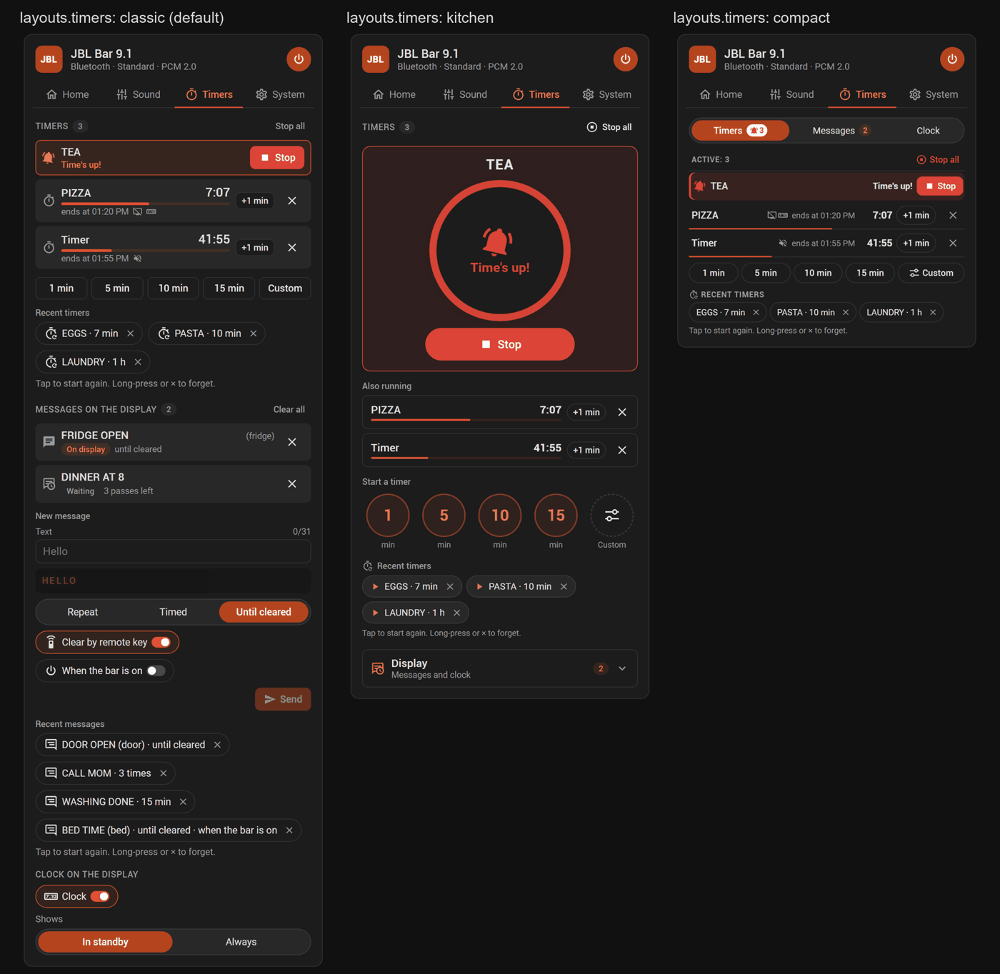
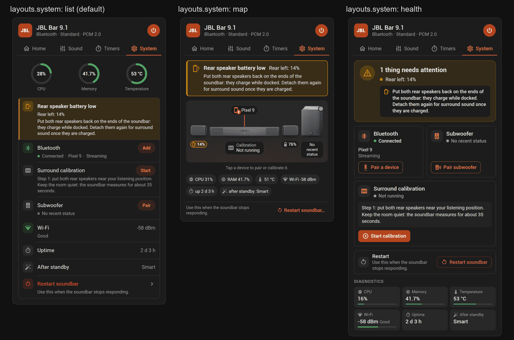

# JBL Bar Card

A Home Assistant dashboard card for the **JBL Bar 9.1** with the
JBL Bar Toolkit integration (`jbl_bar_91`).
One card shows the speakers, source, volume, sound settings, timers, display messages and
system status, and talks to the bar through the integration's own services: no YAML
packages, scripts or helpers are needed.

**Built on two projects you need first:**

```
JBL Bar 9.1  ←  browser remote (kisinga/jbl-bar-toolkit)  ←  jbl_bar_91 integration (naonak/jbl-bar-toolkit-ha)  ←  this card
```

1. [kisinga/jbl-bar-toolkit](https://github.com/kisinga/jbl-bar-toolkit): installs the local
   browser remote on the bar.
2. [naonak/jbl-bar-toolkit-ha](https://github.com/naonak/jbl-bar-toolkit-ha): the Home Assistant
   integration that talks to that remote (0.13.2 or newer).

The card only displays and controls what the integration provides. See
[Requirements](#requirements) for which card blocks need which remote feature.

[](https://my.home-assistant.io/redirect/hacs_repository/?owner=VahaC&repository=jbl-bar-card&category=plugin)
[](https://github.com/VahaC/jbl-bar-card/actions/workflows/validate.yml)
[](https://github.com/VahaC/jbl-bar-card/actions/workflows/build.yml)

| Home | Sound | Timers | System |
|------|-------|--------|--------|
|  |  |  |  |



Screenshots come from the demo page (`npm run dev`) with a simulated bar.

## What you get

The bar runs one command at a time, so every control follows the same rules:

- The control you touched shows that it is waiting until Home Assistant reports the new state.
- A strip says what the bar is doing ("Setting bass level…"), also when the command came from the
  bar's web page or another client.
- Every error from Home Assistant or the bar (for example "undock both rear speakers first") is
  shown in the card. Nothing fails silently.
- Anything your bar, remote or integration version does not have is hidden.
- English, Ukrainian and French, following your Home Assistant language. Light and dark themes,
  from 300 px wide.
- Three layouts for every tab, chosen per tab: see [Layouts](#layouts). The descriptions below
  are of the default layouts; the others show the same information and controls.

### Home

- Room view: rear left and right speakers with their battery level, the bar, the subwoofer with
  the bass level ("Bass 3/5"), and whether the rears are docked or detached.
- Source: TV, HDMI or Bluetooth.
- Volume 0–32: big number, − and + steps, a slider and mute.
- Smart mode and Night chips.
- Playback buttons and what is playing (title, artist, app), only when the current source
  supports them.

### Sound

- Bass 1–5, Center 1–6 (with its gain, "+2.4 dB"), Atmos Low / Mid / High, Rear Low / Mid / High /
  Mute. Rear is disabled with the reason while the rears are docked.
- Audio sync in 10 ms steps (0–250 ms), TV and HDMI only. The bar re-syncs after each change, which
  can take up to a minute; the stepper waits for it.
- Front EQ: status (Active, Waiting, Off, Reset needed, with the bar's reason), preset, and five
  vertical sliders (125 Hz, 500 Hz, 2 kHz, 4 kHz, 8 kHz, −6 to 0 dB). When the bar asks for a reset,
  a **Reset EQ** button selects the Original preset.
- Bass offset −3 to +3 dB in 0.5 dB steps, with its status and error.
- Quick clicks and drags are combined: only the last value is sent, one at a time.

### Timers

- Running timers with a live countdown, progress bar, end time, +1 min and cancel. A ringing timer
  comes first with **Stop**. **Stop all** (with confirmation) when two or more run.
- Quick timers 1 / 5 / 10 / 15 min, and **Custom**: name (with a preview of how the display shows
  it), minutes, sound (off / unless TV / always), show the time left on the bar.
- Recent timers as chips: tap to start again; long-press, right-click or × to forget.
- Display messages: what is on the display or waiting, how long it stays, clear one (×) or
  **Clear all** (with confirmation).
- Compose a message: up to 31 characters with a live counter, a preview in upper case without
  accents, mode repeat ×N / for a time / until cleared, "Clear by remote key" and "When the bar is
  on". Recent messages as chips. The display shows letters A–Z, digits, space and `- . '`; the card
  folds text exactly as the remote does (accents, Œ/Æ/ß, curly apostrophes and dashes, repeated
  spaces), so what the preview shows is what the bar shows. A remote that has messages but not
  "When the bar is on" refuses that option once; the card then hides it for the session.
- The clock on the display: on / off, and In standby / Always.

### System

The default `list` layout:

- Low rear battery warning (below 20 %) naming the speaker, and how to fix it (dock the rears to
  charge them).
- Gauges for CPU, memory and temperature; Wi-Fi signal, uptime and mode after standby as list
  rows. Tap one for its details. Wi-Fi signal and uptime are disabled in Home Assistant by default; the card says how to
  enable them.
- Bluetooth: connected device, Connected badge, **Pair a device** (only on the Bluetooth source;
  the card offers to switch to it).
- Surround calibration: status and the next step ("Start calibration", "Start step 2", "Try
  again"), with the reason when it cannot start (standby, rears docked, subwoofer pairing).
- Subwoofer: status and **Pair**, with the pairing instructions.
- **Restart soundbar**, after a confirmation.

## Requirements

- Home Assistant 2025.1 or newer.
- The **JBL Bar Toolkit (Bar 9.1)** integration (`jbl_bar_91`,
  [naonak/jbl-bar-toolkit-ha](https://github.com/naonak/jbl-bar-toolkit-ha)) **0.13.2 or newer**, set
  up for your bar. The card reads the structured `timers` and `messages` attributes of that version.
- The browser remote from [kisinga/jbl-bar-toolkit](https://github.com/kisinga/jbl-bar-toolkit) on
  the bar. Some blocks need a remote that has the feature; without it the block is hidden:

  | Card block | Remote feature |
  |------------|----------------|
  | Smart mode switch, audio sync | advanced controls |
  | Center level | center-level control |
  | Front EQ (status, preset, bands) | Front EQ support |
  | Bass offset | bass offset (experimental) |
  | Calibration, subwoofer pairing, audio format | setup controls |
  | Mode after standby | `smart_mode_memory` |
  | Timers (+1 min needs `bar91.timer.extend`) | `bar91.timer` |
  | Display messages ("When the bar is on" needs `when_on`) | `bar91.display-message` |
  | Display clock | `bar91.display-clock` |
  | Restart | `bar91.system.reboot` |

- No YAML packages, scripts or helpers: the card calls the integration's services
  (`jbl_bar_91.timer_start`, `jbl_bar_91.display_message`, ...) and the entities directly.

## Installation

### Marketplace or HACS (recommended)

JBL Bar Card is in the default HACS catalog, so you can find it by name:

1. Open **Settings → Marketplace** (Home Assistant 2026.11 and newer, where HACS is built in) or
   **HACS** (older versions). You can also click **Open in Marketplace** at the top of this page
   to go straight to the card.
2. Search for **JBL Bar Card**, open it and install (download) it.
3. The dashboard resource is added for you in storage mode. If you manage dashboard resources in
   YAML, add the one the install dialog shows, with type `module`:

   ```yaml
   lovelace:
     resources:
       # Marketplace (2026.11 and newer)
       - url: /local/community/jbl-bar-card/jbl-bar-card.js
         type: module
       # HACS (older versions)
       # - url: /hacsfiles/jbl-bar-card/jbl-bar-card.js
       #   type: module
   ```

4. Reload the browser.

### As a custom repository (fallback)

Use this only if the search does not find the card, for example in an older HACS that has not
refreshed its catalog yet. Add the repository by hand, then continue with step 2 above:

- **Marketplace**: **Settings → Marketplace → Add from link** (upper-right corner). Under
  **GitHub link**, enter `VahaC/jbl-bar-card`; if you are asked for the type, choose
  **Dashboard**. Select **Add**.
- **HACS**: menu (three dots) → **Custom repositories**. Repository:
  `https://github.com/VahaC/jbl-bar-card`, type: **Dashboard**. Select **Add**.

### Manual

1. Download `jbl-bar-card.js` from the latest
   [release](https://github.com/VahaC/jbl-bar-card/releases) and copy it to
   `<config>/www/jbl-bar-card.js`.
2. **Settings → Dashboards → ⋮ → Resources → Add resource**: URL `/local/jbl-bar-card.js`,
   type **JavaScript module**.
3. Reload the browser.

## Configuration

Add the card from the card picker (search for "JBL Bar") or in YAML:

```yaml
type: custom:jbl-bar-card
entity: media_player.jbl_bar_9_1
```

| Option        | Type    | Default                           | Description |
|---------------|---------|-----------------------------------|-------------|
| `entity`      | string  | the first JBL Bar 9.1 found       | The bar's media player (from the `jbl_bar_91` integration). All other entities are found from it. |
| `name`        | string  | the device name                   | Name in the header. |
| `tabs`        | list    | `[home, sound, timers, system]`   | Tabs to show. |
| `default_tab` | string  | `home`                            | Tab shown when the dashboard opens. |
| `compact`     | boolean | `false`                           | Home only, without tabs. |
| `recent`      | boolean | `false`                           | Show the recent timers and messages even when you have several JBL bars. Those buttons belong to the first bar Home Assistant loaded, so turn this on only on that bar's card. |
| `layouts`     | map     | the first layout of every tab     | Layout per tab, for example `layouts: {sound: mixer, system: health}`. See [Layouts](#layouts). |

Every option is also in the visual editor (layouts under **Tab layouts**).

### Layouts

Every tab comes in three layouts. They show the same information and run the same actions with the
same rules (one command at a time, the reason next to anything that cannot run now); only the look
differs. Pick one per tab:

```yaml
type: custom:jbl-bar-card
layouts:
  home: remote      # classic | remote | media
  sound: mixer      # classic | mixer | cards
  timers: kitchen   # classic | kitchen | compact
  system: health    # list | map | health
```

| Tab | Layouts (the first one is the default) |
|-----|------------------------------------------|
| Home | `classic`: room picture, source, volume slider, chips. `remote`: big keys like the JBL remote, with a volume rocker, power and mute. `media`: a media player with now playing and a volume knob. |
| Sound | `classic`: segmented levels and vertical EQ sliders. `mixer`: every level, EQ band and the bass offset as faders on one console. `cards`: a card per setting with − / +, and an EQ curve you drag by its points. |
| Timers | `classic`: timers, messages and the clock in one list. `kitchen`: the next timer as a big countdown ring, big quick-start buttons, messages folded under Display. `compact`: sub-tabs for timers, messages and the clock, with dense rows. |
| System | `list`: gauges and one compact settings-style list. `map`: the speakers as a picture you tap for their actions. `health`: a health summary with a card per device and diagnostics. |






### Examples

Compact card for a small dashboard:

```yaml
type: custom:jbl-bar-card
entity: media_player.jbl_bar_9_1
compact: true
name: Living room
```

Only sound and timers, opening on timers:

```yaml
type: custom:jbl-bar-card
entity: media_player.jbl_bar_9_1
tabs: [sound, timers]
default_tab: timers
```

### Theming

The card uses your theme's colours. The accent is JBL orange; to change it, set
`jbl-bar-accent` (and `jbl-bar-accent-rgb` as `r, g, b`) in your theme. Text on the accent and
accent-coloured text use darker shades so they stay readable (WCAG AA): set `jbl-bar-accent-fill`
(behind white text) and `jbl-bar-accent-text` (text on the card) when you change the accent.

## Development

```bash
npm ci
npm run dev        # demo page with a fake Home Assistant: http://localhost:5173/demo/index.html
npm test
npm run typecheck
npm run build      # dist/jbl-bar-card.js
```

See [docs/ARCHITECTURE.md](docs/ARCHITECTURE.md) for how the card is organised.

## Credits

- [kisinga](https://github.com/kisinga) for
  [JBL Bar Toolkit](https://github.com/kisinga/jbl-bar-toolkit), the browser remote that runs on
  the bar and makes local control possible.
- [naonak](https://github.com/naonak) for
  [JBL Bar Toolkit for Home Assistant](https://github.com/naonak/jbl-bar-toolkit-ha), the
  `jbl_bar_91` integration whose entities and services this card uses.

## License

MIT © VahaC. The speaker illustrations in `assets/` were drawn for this project and are under the
same license.

Independent project; not affiliated with JBL or Harman. JBL is a trademark of Harman International.
